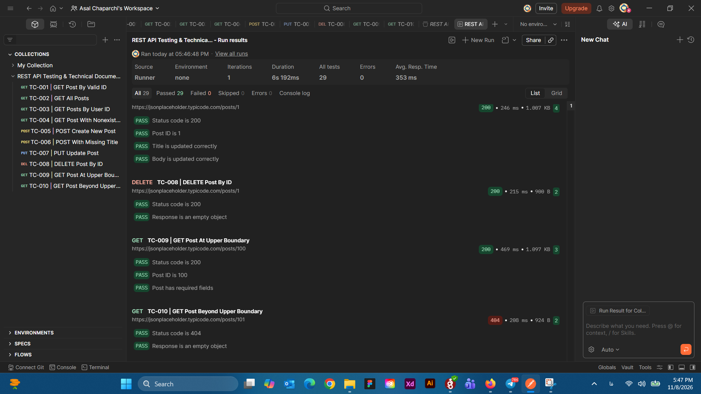

# REST API Testing & Technical Documentation

A hands-on API testing and technical documentation
project using Postman, JSONPlaceholder, and OpenAPI 3.0.

## Project Overview

This project demonstrates practical REST API testing
and technical documentation skills.

The JSONPlaceholder public API was used to design
and execute test scenarios covering HTTP methods,
JSON responses, status codes, and input validation.

The project focuses on API quality assurance,
test case design, and technical documentation.

## Tools and Technologies

- Postman
- JavaScript (Postman Assertions)
- REST API
- HTTP
- JSON
- Swagger Editor
- OpenAPI 3.0
- Markdown
- GitHub

## API Under Test

**API:** JSONPlaceholder

**Base URL:** https://jsonplaceholder.typicode.com

JSONPlaceholder is a free public REST API
used for testing and prototyping.

The project focuses on the `/posts` resource.

## Test Coverage

The following scenarios were tested:

| Test ID | Method | Test Scenario |
|---|---|---|
| TC-001 | GET | Retrieve post by valid ID |
| TC-002 | GET | Retrieve all posts |
| TC-003 | GET | Filter posts by user ID |
| TC-004 | GET | Retrieve nonexistent post |
| TC-005 | POST | Create a new post |
| TC-006 | POST | Submit post without title |
| TC-007 | PUT | Update an existing post |
| TC-008 | DELETE | Delete an existing post |
| TC-009 | GET | Test upper dataset boundary |
| TC-010 | GET | Test beyond upper boundary |

### Testing Techniques

- Positive Testing
- Negative Testing
- Boundary Value Testing
- HTTP Status Code Validation
- JSON Structure Validation
- Data Type Validation
- Response Value Validation
- Automated Assertions using JavaScript

## Test Execution Results

The Postman Collection was executed using
the Postman Collection Runner.

| Metric | Result |
|---|---|
| API Requests | 10 |
| Automated Assertions | 29 |
| Passed | 29 |
| Failed | 0 |
| Execution Errors | 0 |
| Total Execution Time | 6.192 seconds |
| Average Response Time | 353 ms |

**Overall Result: PASSED**

All 29 assertions passed during the recorded
Collection Runner execution.

### Test Execution Evidence



## Project Structure

```text
rest-api-testing-documentation/
├── README.md
├── postman/
│   └── api-tests.postman_collection.json
├── docs/
│   ├── test-cases.md
│   ├── api-documentation.md
│   └── test-report.md
├── openapi.yaml
└── screenshots/
    └── collection-run-results.png
```

## How to Run the Tests

### Prerequisites

- Postman installed
- Internet connection

### Steps

1. Open Postman.
2. Import the collection from:

   `postman/api-tests.postman_collection.json`

3. Open the imported collection.
4. Click **Run**.
5. Select all 10 requests.
6. Set iterations to 1.
7. Run the collection.
8. Review the test results.

No backend installation or database setup
is required.

## Technical Documentation

The project includes the following documents:

### Test Cases

File: `docs/test-cases.md`

Contains test scenarios, inputs, expected results,
actual results, and execution status.

### API Documentation

File: `docs/api-documentation.md`

Contains endpoint descriptions, HTTP methods,
parameters, request bodies, response examples,
status codes, and API limitations.

### Test Report

File: `docs/test-report.md`

Contains execution results, test coverage,
observed behavior, limitations, and conclusions.

### OpenAPI Specification

File: `openapi.yaml`

Documents the API using the OpenAPI 3.0 standard.

The specification can be opened using:

https://editor.swagger.io/

## Observations

### Missing Title Field

A POST request without the `title` field
returned HTTP 201 Created.

This behavior was documented as an observation,
not a confirmed defect.

### Simulated Write Operations

JSONPlaceholder simulates POST, PUT,
and DELETE operations.

Changes are not permanently stored.

### Nonexistent Resources

Requests for nonexistent post IDs returned
HTTP 404 with an empty JSON object.

## Project Limitations

- Testing was performed against a public mock API.
- No authentication or authorization testing.
- No load, stress, or security testing.
- Persistent database changes were not verified.
- Only selected negative and boundary cases were tested.
- No formal performance thresholds were defined.

## Conclusion

This project demonstrates practical experience
in REST API testing, Postman automation,
JSON validation, test case design,
technical documentation, and OpenAPI.

The documented Collection Runner execution
completed with 29 passed assertions
and zero failures.
